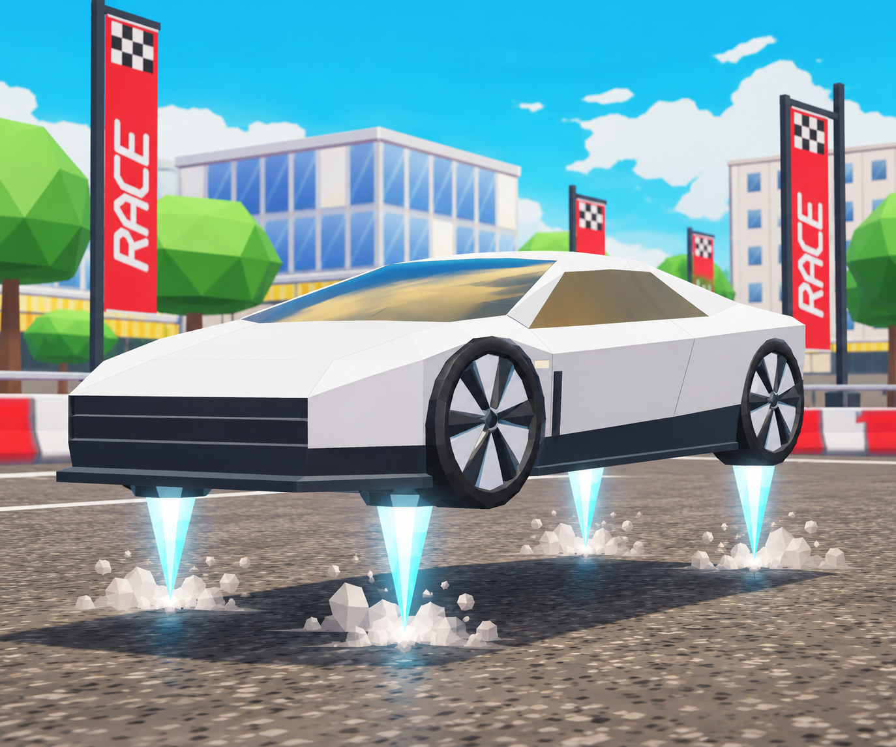
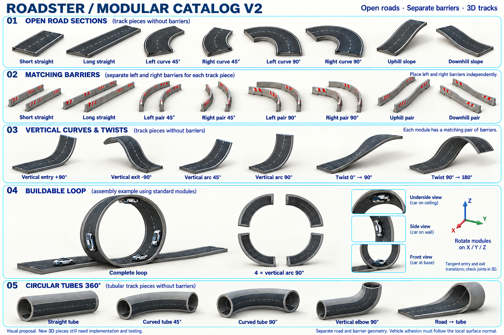
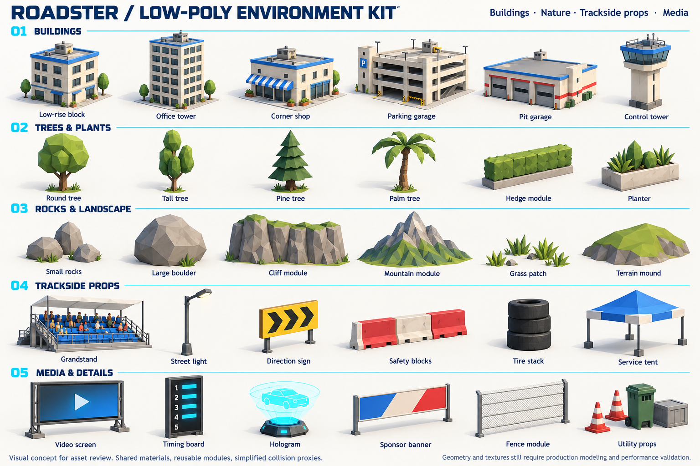
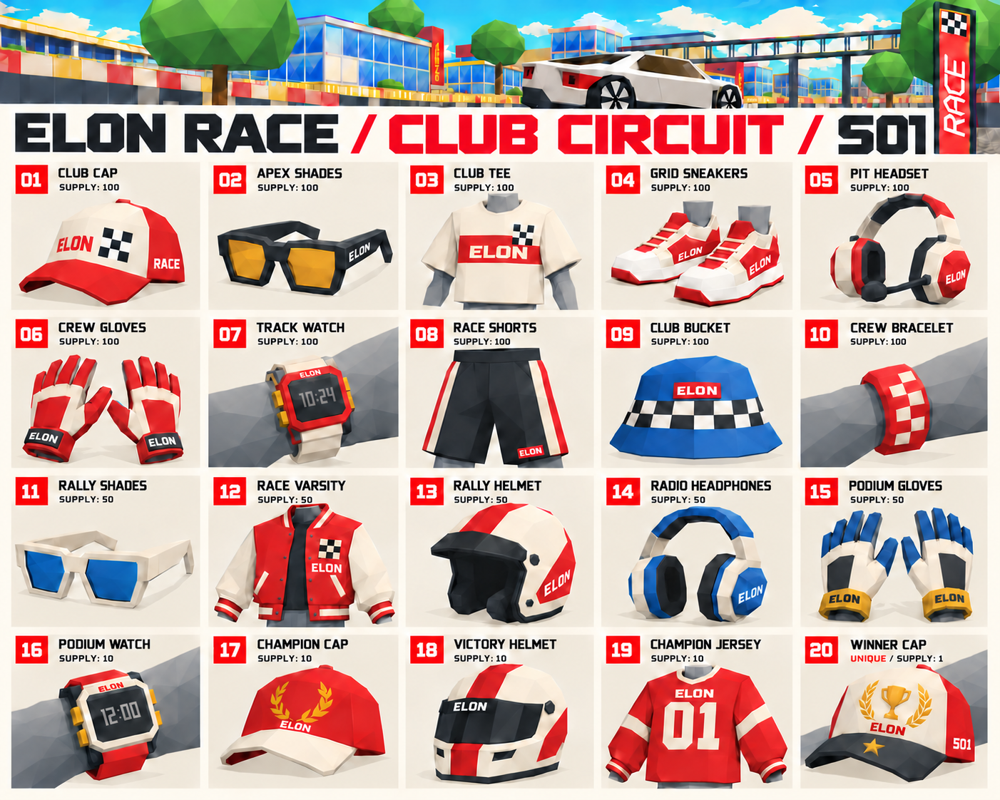

# ELON RACE: Game Design, Season 01

Design proposal · 26 Oct 2026

Source decks: [`docs/design/elon-race-game-design.pdf`](../docs/design/elon-race-game-design.pdf) (arcade edition) and the original
7-page essentials deck. This document carries the same content in text form.

## 1. The concept

**Arcade racing in Decentraland. Community-built tracks. A season you can wear.**

Master the racing line, combine boost and thrusters, and tackle upside-down sections. Build a track, host a
tournament or progress through ranked to earn wearables.

| | |
|---|---|
| **Style** | Low poly retro |
| **Mode** | Multiplayer |
| **Target race length** | 3-5 min |
| **Season 01 wearables** | 20 |

> Existing foundation: driving and tracks. Proposed systems: editor, tournaments and seasons.

## 2. The experience: easy to start, hard to master

Equal car performance for everyone. Skill decides; wearables are cosmetic.

| | Skill | What the player does |
|---|---|---|
| 01 | **Find your line** | Brake, find the racing line and carry speed through the corner. |
| 02 | **Manage charge** | Spend charge on boost or save it to correct a jump. |
| 03 | **Take the leap** | Jump, roll in mid-air and conquer upside-down sections. |

### Core loop

**Practice → Compete → Progress → Equip → Share**

### Controls

| Key | Action |
|---|---|
| `WASD` | Drive |
| `W` `W` (double tap) | Boost |
| `SPACE` | Thrusters |
| `E` | Air roll |
| `F` | Respawn |

## 3. Track editor: build your race, piece by piece

Pick modular road sections, snap compatible connectors together, then test and publish.

| | Step | Details |
|---|---|---|
| 01 | **Assemble** | Place straights, corners and slopes. Duplicate and rotate modules in 3D. Connectors align their position and orientation. |
| 02 | **Add the challenge** | Place barriers independently on each side. Add checkpoints, charge pads and marked jump or gap connections. |
| 03 | **Test and publish** | Check joints, clearance and safe respawns. Complete a server-validated lap. Published versions remain locked. |

### Creator loop

**Pick pieces → Snap & rotate → Decorate → Drive & check → Publish**

Track data stores piece versions, transforms and connections. Client and server build matching geometry; ranked
uses curated track versions.

## 4. Community generated content: straights, curves, a third dimension

- **In-world track editor.** Players build tracks inside Decentraland with these pieces, then share them with the
  community.
- **Road + barriers.** Open road sections with separate matching left and right barriers.
- **3D modules.** Vertical arcs, twists and tubes extend the catalog. Loops need clear entry and exit connections.

> Concept reference. New 3D pieces and surface adhesion require implementation and driving tests before release.

## 5. Environment kit: give every track its own identity

- **Build the world.** Buildings, garages, trees, rocks and landscape modules create a coherent low-poly setting.
- **Set the stage.** Grandstands, signs, safety props, screens and banners give community events a distinct setting.

> Visual asset reference. Shared materials, simplified collisions and performance validation guide production.

## 6. The competition: ranked and tournaments

### Ranked (official season)

- Asynchronous challenges against recorded benchmarks: compete even as the very first player.
- Three daily tracks. Your best result on each earns 1 to 4 points. Improving it awards only the difference.
- No car-to-car collisions. The server validates times and checkpoints.

### Tournaments (community events)

- Communities choose tracks, dates, laps and public or invite-only access.
- Initial format: asynchronous time trials on 1 to 5 tracks. The lowest combined best valid times win.
- Rules and track versions lock when the event opens. Event prizes are separate from ranked rewards.

### Season numbers

| Value | Meaning |
|---|---|
| **42** | days per season |
| **12** | daily point cap (3 tracks × 4 points) |
| **315** | points to unlock the final wearable |

> S01 proposal: cumulative points, no demotion. Initial benchmarks are clearly labeled as game reference times.

## 7. The rewards: Club Circuit, 20 wearables

Retro low-poly clothing and accessories that share the palette and shapes of the game world.

- **15 accessories:** caps, shades, helmets, headphones, watches, a wristband and gloves.
- **5 clothing and footwear:** a tee, shorts, sneakers, a varsity jacket and a jersey.

| Rarity | Designs | Supply |
|---|---|---|
| Legendary | 10 | 100 per design |
| Exotic | 5 | 50 per design |
| Mythic | 4 | 10 per design |
| Unique | 1 | Winner Cap: 1 copy |

> Unique Winner Cap: first validated unlock at 315 points. Other rewards subject to stock. No driving advantages.
